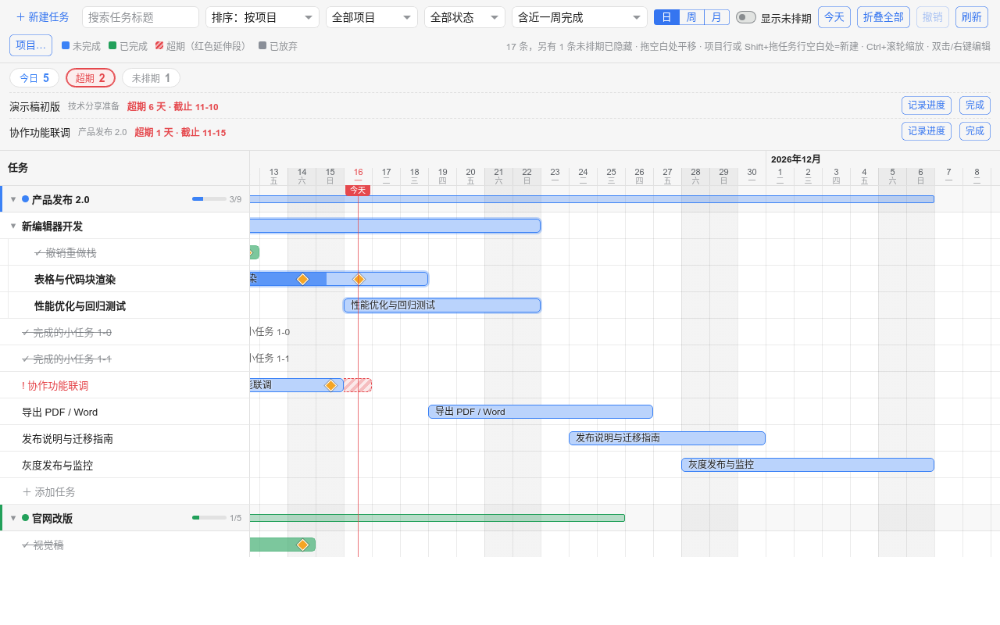
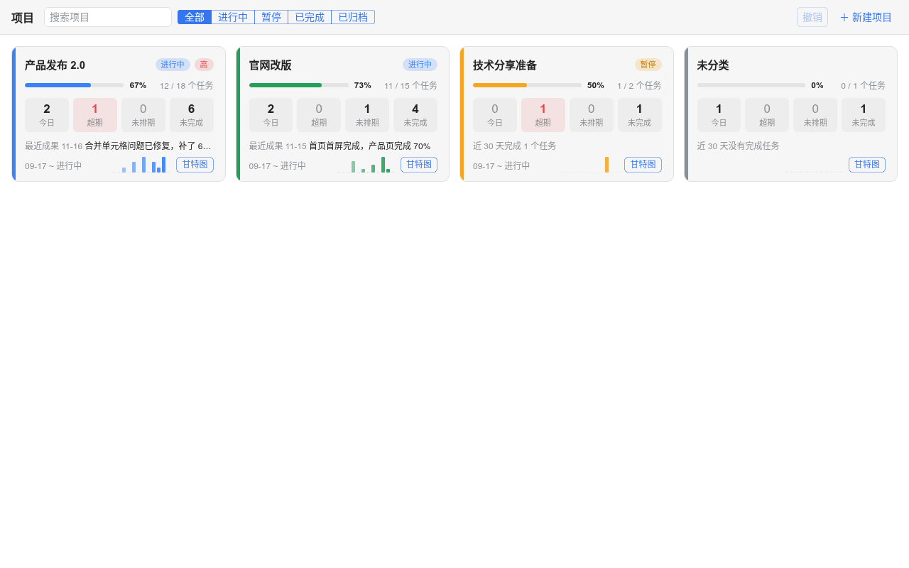
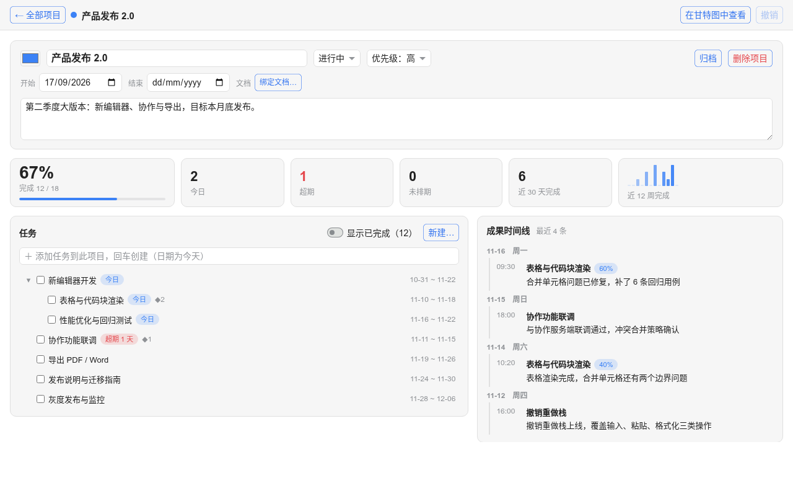

# Task Gantt

**English** | [简体中文](./README_zh_CN.md)

A Gantt chart and project pages for your tasks inside SiYuan: group tasks by project, drag bars to reschedule, see what is due today or overdue at a glance, log the results you achieve, and create and bind documents to tasks. Standalone — it does not depend on any other plugin. Tasks and projects are stored in the plugin's own storage.

(The screenshots use demo data.)

## Quick start

1. Click the Gantt icon in the top bar, or run the command "Open Task Gantt".
2. The first time it is empty: open the second top-bar icon (Projects) and create a project, then use "＋ New task" in the chart.
3. The red line is today. Drag a bar to reschedule it, right-click a task for its menu.

## Reading the chart

| Element | Meaning |
|---|---|
| Purple bar | Not started yet: open, and its first day is still ahead |
| Blue bar | Open (in progress, or started and not done) |
| Green bar | Done (struck-through title, ✓ prefix) |
| Yellow bar | Stalled (never overdue, no red tail) |
| Red hatched tail | Overdue: open and the end date has passed; drawn from the end date to today, title prefixed with `!` |
| Ring / bold title | In progress today |
| Bar ending with ▸ | "In progress" task with no end date: drawn from its start to today and never counted as overdue |
| Grey | Abandoned |
| Dashed bar | Only an "available from" or a deadline date; read-only |
| Parent bar | Summary of its subtasks; read-only. It turns green only when the parent itself is marked done — with all subtasks done but the parent still open, it stays blue (red tail if overdue) so you remember to close it |
| Orange diamond | A result was logged on that day |

Hover a bar or a title for a card with project, dates, status, progress and the latest results.

### Today / overdue / unscheduled strip

Under the toolbar: `Today N`, `Overdue N`, `Unscheduled N`, `Stalled N`. Click one to open its list; click a title to jump to the task on the chart; each row has "Log progress", "Done" (and "Schedule for today" for unscheduled tasks).

- **Today**: open leaf tasks whose date range covers today, or that are open-ended and in progress, or due today. Sorted by priority.
- **Overdue**: open tasks whose end date has passed, most overdue first. Tasks without an end date are never overdue.
- **Unscheduled**: tasks with no date at all.
- **Stalled**: open tasks whose status is "Stalled" (pick it in the edit dialog, or right-click → "Mark as stalled / Resume"). They are drawn yellow and are never counted as Today, Overdue or Unscheduled — an end date in the past does not make them overdue. Each row has a "Resume" button.
- Right-click a task → "Hide from summary (with subtasks)" keeps long-lived container tasks out of Today / Unscheduled (overdue is never hidden). Hidden tasks are listed under "Hidden N" and can be restored.

## Rescheduling

- Drag the middle of a bar to move it; drag the left / right edge to change the start / end date.
- For an unscheduled task, drag on its empty row to set the dates.
- Drag the empty timeline or the date header to pan; `Ctrl` + wheel switches day / week / month around the mouse position; drag the right edge of the "Task" header to resize the label column.
- Every change can be undone with the Undo button or `Ctrl+Z` (30 steps, this session). A backup of the task file is written before the first change of each day.

## Creating tasks

| Entry | How |
|---|---|
| Toolbar | "＋ New task": title, project, parent task (task tree, searchable), dates, priority, status. Leave the end date empty for an open-ended task |
| Drag | Drag across a project row to open the same dialog with those dates; `Shift` + drag on a task row creates a subtask |
| Add row | The last row of each project: type a title and press Enter (dated today), keep typing to add more |

## Right-click menu

Edit task · Mark done / not done (asks when it was actually finished, default now) · Log progress · View progress log · Hide from summary · Open the bound document · Create document and bind… · Delete task…

### Log progress

Right-click → "Log progress…" each time you get a result: free text, an optional progress percentage (written to the task's `customProgress` and drawn as the bar's fill; 100% can also mark it done), an editable time for back-dating, and an option to append a line to the bound document. Results are rendered as Markdown (lists, code blocks, tables, links…) in the project timeline and the progress log. Records are shown as diamonds on the timeline and gathered in the project page's timeline.

### Create document and bind

Right-click → "Create document and bind…": type a title, pick a parent document from the notebook tree (all collapsed at first; click ▸ to open a level, click a name to choose it; right-click a row → "New subdocument" to create a missing level, name it and press Enter) or search for one (keywords separated by spaces; ★ marks the project's document and the last parent used). The new document becomes the task's bound block. If a bound document is later deleted, the hover card says so and the menu offers "Unbind" or "Re-create and bind".

## Project page

Second top-bar icon, command "Open Projects", or the "Projects…" button on the chart toolbar.

**Overview**: one card per project — status (active / paused / done / archived), priority, progress bar, today / overdue / unscheduled / open counts, latest result, a 12-week completion sparkline and a shortcut to the chart filtered to that project. Filter by status, search, and an "Unclassified" card for tasks without a project.

**Detail**: edit name, color, status, priority, dates and notes inline; bind a document; archive or delete (deleting keeps the tasks as unclassified); stat tiles; a task tree with completion checkboxes, quick add, edit, log progress, add subtask and delete; and a results timeline across the project's tasks. "Organize…" moves unclassified tasks into a project in one undoable step.

## Toolbar

Search · Sort (by project, or flat by start date — on equal start dates parents come first and same-day subtasks sit under their parent) · Project filter · Status filter · Completed range (open only … all, default 30 days) · Zoom · Show unscheduled · Today · Collapse all · Undo · Refresh.

## Data

Everything lives in `data/storage/petal/siyuan-plugin-task-gantt/`:

| File | Content |
|---|---|
| `tasks.json`, `projects.json` | Tasks and projects |
| `backup-reminder-YYYYMMDD.json` | Daily backup before the first change of the day |
| `progress-log.json` | Logged results |
| `summary-hidden.json` | Tasks hidden from the summary |

When you bind a document the plugin writes `bookmark`, `custom-bind-reminders` and `custom-task-projectId` attributes to the document block; they are plain markers and the plugin does not depend on them.

## Not included

Calendar, kanban board, Pomodoro timer, reminders / notifications, habit tracking. Repeating tasks are not supported (existing ones are read-only on the chart).

## License

MIT
