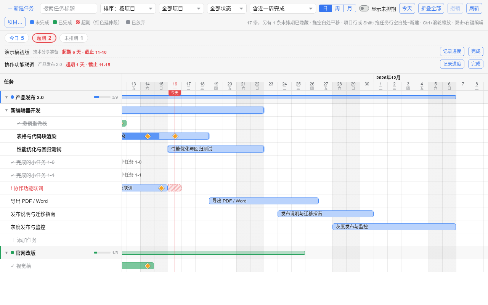
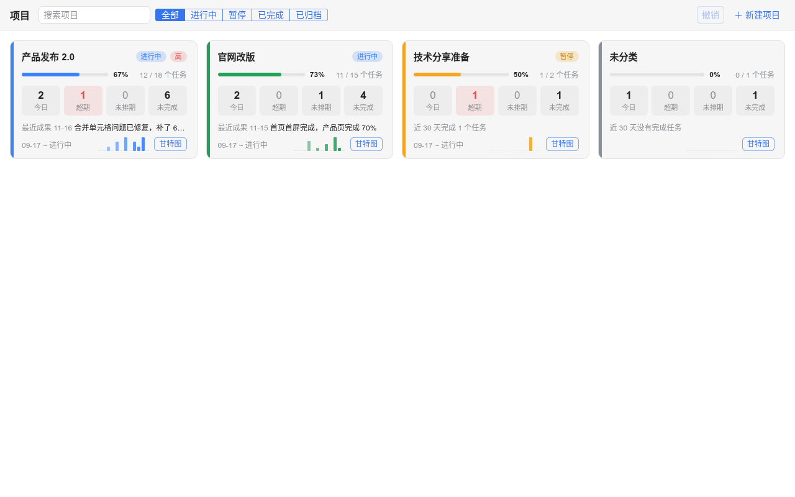

# 任务甘特图

[English](./README.md) | **简体中文**

（截图为演示数据）

把任务画成甘特图：按项目分组、子任务缩进、拖拽改期、右键创建文档、记录每次的成果。

> **独立运行**：不依赖其他插件。任务和项目保存在本插件自己的存储里（`data/storage/petal/siyuan-plugin-task-gantt/`），第一次打开是空的：先点工具栏「项目…」建项目，再「＋ 新建任务」。

## 快速开始

1. 点击顶栏的甘特图图标，或在命令面板运行「打开任务甘特图」。
2. 红线是今天（顶部有「今天」标签）。拖动任务条改期，右键任务打开菜单。
3. 工具栏左侧「＋ 新建任务」可以直接建任务。

## 今日与超期

工具栏下面有一条摘要：`今日 N`、`超期 N`、`未排期 N`。点哪一块就展开对应清单，没有超期时显示绿色的「无超期任务」。

- **今日**：未完成的末级任务，且日期范围覆盖今天；或没设结束日期、状态为进行中、已开始；或今天截止。按优先级排序。
- **超期**：设了结束日期且早于今天的未完成任务，按超期天数从多到少排。没设结束日期的任务不算超期。
- **未排期**：没有任何日期的未完成末级任务，进行中的在前，再按短期、长期、优先级排。不计入「今日」。每行有「排到今天」按钮，把开始日期设为今天。
- 点标题会在图中定位到该任务（自动展开父级、清除搜索和状态筛选，并闪一下）；每行有「记录进度」和「完成」按钮。
- **不在摘要中显示**：右键任务选「不在摘要中显示（含子任务）」，它和它的所有子任务不再计入「今日」「未排期」（适合长期存在的容器任务）。超期照常显示。摘要里出现「已隐藏 N」，点开可以逐个「恢复显示」。标记保存在 `data/storage/petal/siyuan-plugin-task-gantt/summary-hidden.json`，甘特图本身不受影响。
- 数字跟随「项目」筛选，不受搜索框影响；展开状态会被记住。

## 看图

| 元素 | 含义 |
|---|---|
| 紫色条 | 未开始：未完成，且开始日期还在今天之后 |
| 蓝色条 | 未完成（进行中，或已开始未完成） |
| 绿色条 | 已完成（标题划线，前缀 ✓） |
| 红色斜纹尾巴 | 超期：未完成且结束日期早于今天，从结束日接到今天线，标题前加 `!` |
| 带光圈、标题加粗 | 今天正在进行的任务 |
| 右端带 ▸ 的持续条 | 没设结束日期的「进行中」任务，从开始日延伸到今天，不算超期 |
| 灰色 | 已放弃 |
| 虚线条 | 只有「可开始日期」或「截止日期」，只读 |
| 父任务条 | 子任务跨度汇总，只读；项目汇总条用项目自己的颜色 |
| 橙色菱形 | 这一天有成果记录 |

悬停任务条或标题会显示信息卡：项目、日期、状态、进度、最近 3 条成果记录等。

## 改期与排期

- **整体平移**：拖任务条中部。
- **调整起止**：拖左 / 右边缘。没设结束日期的持续条，拖右边缘可补上结束日期，拖中部或左边缘只改开始日期。
- **给未排期任务排期**：在它所在行的空白处按住拖一段。
- **吸附与提示**：拖动时显示吸附虚线和日期提示。
- **保存**：改动写入本插件自己的 `tasks.json`；每次改动前都能用 `Ctrl+Z` 撤销。
- **备份**：每天第一次改期前，会把 `reminder.json` 备份到 `data/storage/petal/siyuan-plugin-task-gantt/backup-reminder-YYYYMMDD.json`。

## 新建任务

| 入口 | 做法 |
|---|---|
| 工具栏 | 点「＋ 新建任务」，填标题、项目、父任务（任务树，可搜索）、起止日期、优先级、状态。结束日期留空即持续进行。「创建并编辑」会在创建后打开编辑弹窗继续补充时间、备注 |
| 拖一段 | 在项目行上按住拖出日期范围，用它打开同一个弹窗；在任务行空白处 `Shift` + 拖，则新建该任务的子任务 |
| 添加行 | 每个项目最后一行「＋ 添加任务」，输入标题回车即创建（日期为今天），可连续录入，`Esc` 取消 |

在时间轴空白处右键，也可以「在此新建任务 / 新建子任务 / 排期到这一天」。新建的任务不绑定思源块，均可撤销。

## 右键菜单

| 菜单项 | 说明 |
|---|---|
| 编辑任务 | 打开任务编辑弹窗（双击任务条同样）：标题、项目、父任务、起止日期、起止时间、优先级、状态、备注。不填日期即未排期，只填结束日期即截止任务 |
| 标记完成 / 取消完成 | 完成父任务时会提示，并一并完成未完成的子任务 |
| 记录进度… | 见下一节 |
| 查看进度记录 | 查看、编辑、删除成果记录 |
| 打开所在文档 / 块 | 跳转到绑定的文档 |
| 创建文档并绑定… | 未绑定文档、未完成、非重复的任务可用，见「创建文档并绑定」 |

## 记录进度

每次有成果，右键任务 →「记录进度…」记一条：

- **成果内容**：多行文字，`Ctrl+Enter` 提交。
- **进度**：可选的百分比滑块，会写入任务的 `customProgress`，条上的填充比例随之变化；拉到 100% 可同时标记完成。
- **时间**：默认现在，可以改成补记。
- **同步到文档**：任务绑定了文档时可勾选，在文档末尾追加一行 `- **时间**（进度 N%）内容`。

记录保存在本插件自己的 `data/storage/petal/siyuan-plugin-task-gantt/progress-log.json`，不改动任务的备注。有子任务的父任务进度由子任务算出，只记文字。「记录进度」可用 `Ctrl+Z` 撤销（含进度值和记录本身），写入文档的那一行不能撤销。

## 创建文档并绑定

右键任务 →「创建文档并绑定…」：

1. 输入文档标题。
2. 选择父文档：下方直接显示所有笔记本的目录树（初始全部折叠），点 ▸ 展开一层，点名称选中；也可以按路径关键字搜索，多个关键字用空格分隔。★ 标出项目绑定的文档和上次使用的父文档，默认选中第一个 ★。不选则建在所选笔记本根目录。
3. 创建后自动把该文档设为任务的绑定块（写入 `blockId` / `docId` / `docTitle`，并给文档块写 `bookmark`、`custom-bind-reminders`、`custom-task-projectId` 三个属性），可选创建后打开。

此操作不能用 `Ctrl+Z` 撤销（文档已在思源中创建）。

绑定的文档如果之后被删除，悬停卡片会提示「文档已被删除」；右键菜单改为「解除绑定」（可撤销）和「重新创建文档并绑定…」，直接点「打开」时也会询问是否解除绑定。

## 工具栏

| 功能 | 说明 |
|---|---|
| 搜索 | 按标题搜索，支持中文输入法。筛选时保留命中任务的父级，并自动展开 |
| 状态 | 全部 / 只看超期 / 只看进行中 / 只看本周 |
| 排序 | 按项目（默认，项目分组 + 子任务层级）或按开始时间（平铺，越早越靠上，开始日期相同时有子任务的排前面，且与父任务同一天开始的子任务紧跟在父任务下面，左侧显示所属项目） |
| 完成范围 | 仅未完成 / 近一周 / 近 30 天 / 近三个月 / 近半年 / 近一年 / 全部（默认近 30 天）。按「完成时间」判断，没有完成时间的退回按结束日期。选择会被记住 |
| 缩放 | 日 / 周 / 月，也可 `Ctrl` + 滚轮（以鼠标所在日期为中心） |
| 折叠全部 / 展开全部、今天 | 折叠或展开所有分组；回到今天 |

## 手感与撤销

- 拖空白处或日期表头可平移。
- 拖「任务」表头右边缘可调整左侧列宽，会记住。
- 撤销：拖拽改期、标记完成 / 取消完成、新建、排期、记录进度都会记录。操作后底部弹出「撤销」按钮，也可点工具栏「撤销」或在甘特图内按 `Ctrl+Z`（最多 30 步，仅本次会话）。撤销按整条任务记录还原。

## 项目页

顶栏第二个图标（或命令「打开项目管理」、甘特图工具栏的「项目…」）打开项目页，用来按项目看全局。

**总览**：每个项目一张卡片——颜色条、名称、状态（进行中 / 暂停 / 已完成 / 已归档）、优先级、完成进度条（已完成 / 总数）、今日 / 超期 / 未排期 / 未完成四个数字、最近一条成果、近 12 周完成数的小柱图，点「甘特图」只看这个项目。顶部可按状态筛选、搜索；没有项目的任务集中在「未分类」卡片里。

**项目详情**（点卡片进入）：
- 顶部直接改：名称、颜色、状态、优先级、起止日期、说明，还能绑定一个文档（点按钮打开，可更换或解除）；信息区右侧有「归档」和「删除项目」按钮（删除不会删任务，它们变成未分类，且不能撤销）。
- 一排统计：完成进度、今日、超期、未排期、近 30 天完成、近 12 周完成趋势。
- 左边任务树：勾选完成，点标题编辑，鼠标移上去有「记录」「＋子」「删除」；顶部输入框回车就能往这个项目加任务；可折叠、可显示已完成。
- 右边成果时间线：这个项目所有任务的成果记录按日期汇总，点任务名查看它的全部记录，写周报时一目了然。
- 「整理这些任务…」：在「未分类」里把任务成批归入某个项目（子任务一起移动，可撤销）。

## 任务

- **编辑任务**：双击任务条，或右键「编辑任务」。
- **删除任务…**：右键菜单，连同子任务和它们的成果记录一起删，可 `Ctrl+Z` 撤销。

没有日历、看板、番茄钟、提醒通知、习惯打卡，也不支持重复任务（旧数据里的重复任务在甘特图里只读）。

## 数据位置

| 内容 | 位置（均在 `data/storage/petal/siyuan-plugin-task-gantt/` 下） |
|---|---|
| 任务、项目 | `tasks.json`、`projects.json` |
| 每日备份 | `backup-reminder-YYYYMMDD.json`（每天第一次改动前） |
| 成果记录 | `progress-log.json` |
| 摘要中隐藏的任务 | `summary-hidden.json` |

## 注意

- 重复任务的完成逻辑较复杂，甘特图暂不支持标记完成。
- 绑定文档时写入文档块的 `custom-bind-reminders` 等属性只是标记，本插件不依赖它们。

## 许可

MIT
